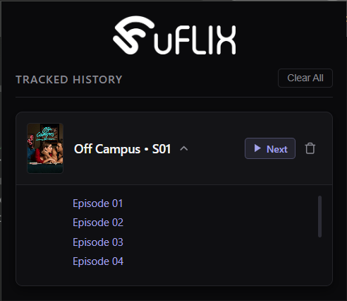

# Uflix Episode Tracker

A lightweight, custom Chrome extension designed specifically for uflix.to. Never lose your place in a series again—this extension automatically tracks your watch progress and saves it locally, keeping your current season and episode just a click away in a fast-loading popup UI.


_(Replace this placeholder with a screenshot of your extension popup)_

## ✨ Features

- **Automatic Tracking:** Uses precise XPath querying and DOM parsing to detect exactly which season and episode you are currently watching on uflix.to.
- **Offline Storage:** Watch progress is persistently synced using Chrome Local Storage. No accounts, no external databases, and no tracking APIs.
- **Quick Access Popup:** Click the extension icon to instantly view your current progress via a clean, accessible interface.
- **Zero Dependencies:** Built entirely with vanilla JavaScript, HTML, and CSS for maximum performance and a minimal footprint.

## 🚀 Installation (Developer Mode)

To use or test this extension locally in Google Chrome:

1. Download or clone this repository to your local machine.
2. Open Chrome and navigate to `chrome://extensions/`.
3. Enable **Developer mode** using the toggle switch in the top right corner.
4. Click the **Load unpacked** button in the top left.
5. Select the folder containing the extension files.
6. Pin the extension to your toolbar for easy access while browsing uflix.to!

## 📁 File Structure

```text
├── manifest.json      # Chrome extension configuration and permissions
├── content.js         # Injects into uflix.to to parse the DOM via XPath
├── popup.html         # The interface displayed when clicking the extension icon
├── popup.js           # Logic to retrieve and render saved data from storage
├── styles.css         # Styling for the popup interface
├── icon.svg           # Extension icon
└── assets/
    └── screenshot.png # Repository preview image
```
